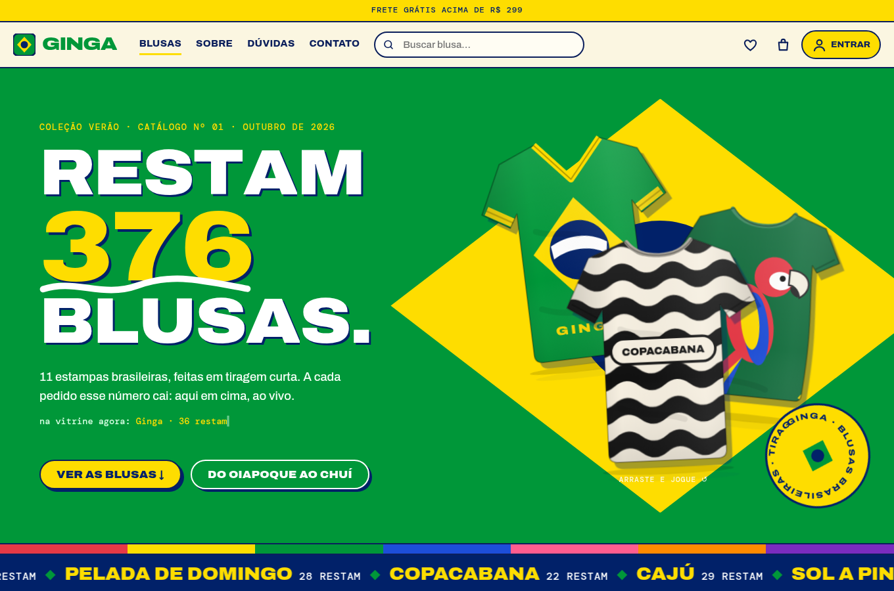
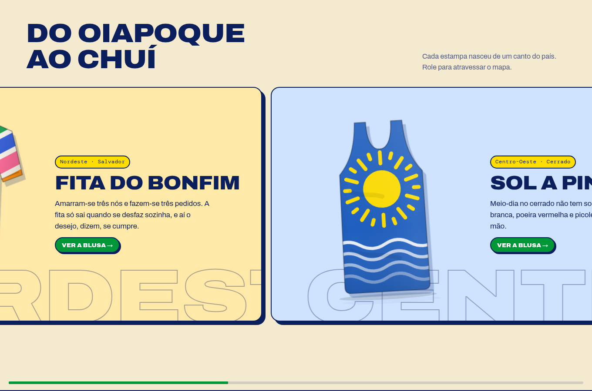
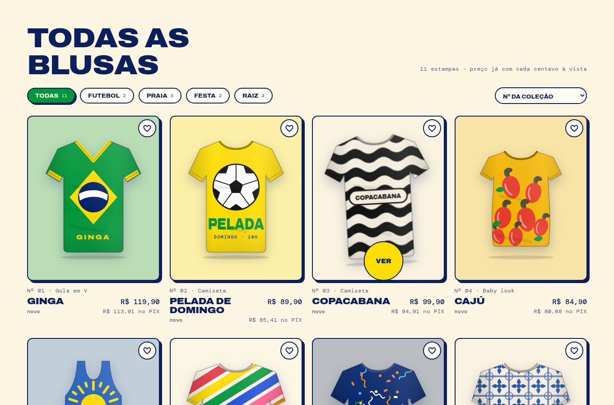
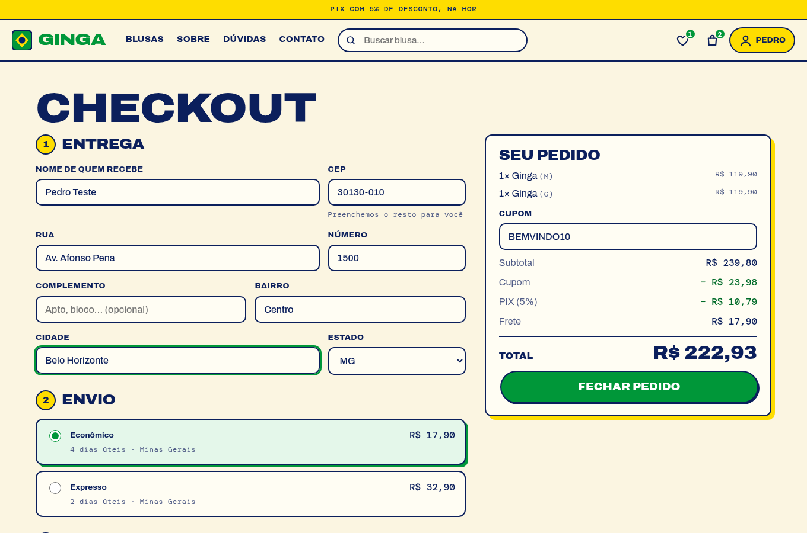
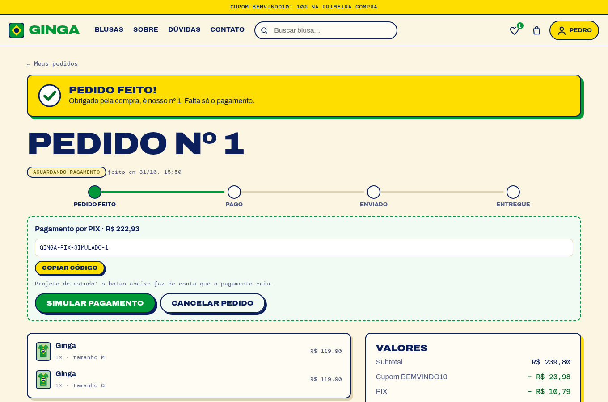
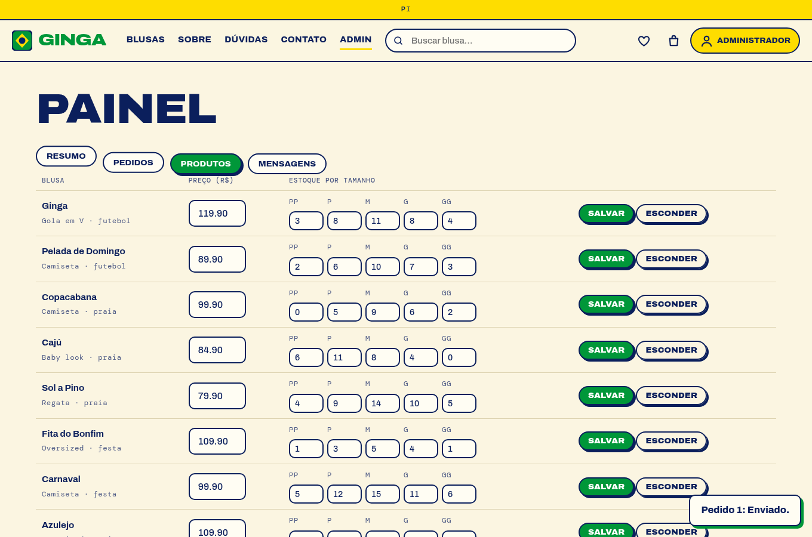

# Ginga — blusas brasileiras

Loja online de blusas com estampa brasileira em tiragem curta: copacabana, azulejo, fita do Bonfim, arara, cajú, cobogó, carnaval. Tem vitrine, filtros, busca, favoritos, avaliações, sacola com cupom, frete por CEP, checkout com endereço e pagamento, acompanhamento de pedido e painel de administração. API em **Express + SQLite** e front em **React + Vite**, animado com **GSAP**.

**Demo online:** https://pedromaxis.github.io/ecommerce-camisas/ (a loja inteira roda no navegador, sem servidor: cadastro, sacola, cupom, checkout e painel do admin com `admin@ginga.local` / `admin-local-123`; os dados voltam ao início a cada visita).

| Hero | Do Oiapoque ao Chuí | Vitrine |
|---|---|---|
|  |  |  |

| Blusa | Checkout | Pedido | Painel |
|---|---|---|---|
|  |  |  |  |

> Projeto de estudo: nenhum pagamento é processado de verdade (o pagamento é simulado na página do pedido). As estampas são desenhos originais em SVG, sem escudos de clube, CBF ou marcas.

## A loja

- **Vitrine** com 11 estampas em 5 cortes (camiseta, baby look, regata, gola em V, oversized), filtro por categoria, ordenação e busca no topo.
- **Estoque por tamanho**, "últimas unidades" e tamanhos esgotados bloqueados. O número gigante da hero (`Restam 384 blusas`) é a soma do estoque real e cai a cada pedido.
- **Página da blusa** com guia de medidas por corte, frete e prazo por CEP, favoritos, história da estampa, avaliações e sugestões.
- **Sacola** com quantidades, cupom e frete grátis a partir de R$ 299.
- **Checkout** com busca de endereço pelo CEP (ViaCEP), escolha de envio (econômico ou expresso) e pagamento (PIX com 5% off, cartão, boleto). Os totais vêm sempre do servidor.
- **Pedido** com linha do tempo (feito, pago, enviado, entregue), pagamento simulado e cancelamento com devolução ao estoque.
- **Conta** (nome e senha), **favoritos**, **avaliações** (só quem comprou avalia, uma por pessoa), **contato**, **newsletter**, **sobre** e **dúvidas frequentes**.
- **Painel admin**: faturamento e alertas de estoque, pedidos (avançar ou cancelar), produtos (preço, estoque, esconder, criar) e mensagens recebidas.

Cupons de teste: `BEMVINDO10` (10%), `CORRE20` (20% acima de R$ 250) e `FRETEBRASIL` (frete grátis acima de R$ 150).

## GSAP: o que cada plugin faz aqui

| Plugin | Onde |
|---|---|
| **ScrollTrigger** | "Do Oiapoque ao Chuí" prende na tela e anda para o lado (pin + scrub + `containerAnimation`); cartões entram em lote; faixa de estoque acelera com a rolagem; barra do topo some ao descer |
| **SplitText** | Manchete e nome da blusa sobem letra por letra; o manifesto da página Sobre "acende" palavra por palavra |
| **Flip** | Filtrar e ordenar a vitrine: cada cartão voa até o novo lugar |
| **Draggable + InertiaPlugin** | As blusas da hero podem ser arrastadas e atiradas, com inércia |
| **MotionPathPlugin** | Ao pôr na sacola, a blusa descreve uma curva até o ícone |
| **DrawSVG** | Rabisco sob o número da hero e visto de confirmação do pedido |
| **MorphSVG** | Carregamento: a gota vira blusa e volta |
| **TextPlugin** | Aviso do topo e linha "na vitrine agora" são digitados |
| **Physics2D** | Confete nas cores da bandeira quando o pedido é fechado |
| **ScrollToPlugin** | Botões da hero e âncoras das dúvidas rolam suavemente |
| **CustomEase / CustomBounce / CustomWiggle** | Ease própria da marca, "salto" do contador da sacola e sacudida de erro |
| **quickTo, matchMedia, `useGSAP`** | Inclinação 3D dos cartões, fonte variável que afina perto do mouse, cursor "Ver"; tudo respeita `prefers-reduced-motion` e mouse/toque |

## Rodando

Precisa de Node 22.13 ou mais novo (usa o SQLite embutido, `node:sqlite`: nada para compilar).

```bash
npm install
npm --prefix Client install

cp .env.example .env        # opcional; defina ADMIN_PASSWORD para criar o administrador
npm run dev                 # API em http://localhost:3000 (cria o banco e o catálogo na 1ª vez)
npm --prefix Client run dev # front em http://localhost:5173 (proxy de /api para a porta 3000)
```

O administrador é criado na primeira execução (banco vazio) com `ADMIN_EMAIL` e `ADMIN_PASSWORD`.

```bash
npm test                        # API: 28 testes (node:test + supertest)
npm --prefix Client test        # front
npm --prefix Client run lint
npm --prefix Client run build
```

### Demo no GitHub Pages

O Pages só serve arquivos estáticos, então o demo executa **as mesmas rotas** de `src/routes` no navegador: um mini-Express (`Client/src/demo/express-mini.cjs`) faz o papel do Express e um adaptador sobre [sql.js](https://github.com/sql-js/sql.js) (SQLite em WebAssembly) faz o do `node:sqlite`. O esquema (`src/esquema.js`) e o catálogo (`scripts/catalogo.js`) são compartilhados com o servidor. No demo, JWT e bcrypt são substituídos por versões simplificadas e **não seguras** (`jwt-demo.cjs`, `bcrypt-demo.cjs`), só para a sessão de demonstração. Para gerar: `npm --prefix Client run build:demo`.

## Em produção

`npm --prefix Client run build` gera `Client/dist`, e o Express passa a servir o front no mesmo endereço da API. O `render.yaml` descreve o serviço no Render (disco persistente para o SQLite). Em produção **`JWT_SECRET` é obrigatório**: sem ele o servidor se recusa a subir.

## API

Todas as rotas ficam em `/api`. Erros vêm como `{ "error": "mensagem em português" }`. 🔒 exige `Authorization: Bearer <token>`; 👑 exige administrador. Dinheiro sempre em centavos (`priceCents`, `totalCents`…).

| Método | Rota | O que faz |
|---|---|---|
| POST | `/users/register`, `/users/login` | `{ name?, email, password }` → `{ token, user }` |
| GET / PATCH | `/users/me` 🔒 | usuário atual; trocar nome |
| POST | `/users/me/password` 🔒 | `{ currentPassword, newPassword }` |
| GET | `/products`, `/products/:id` | catálogo com estoque, categoria, corte e nota |
| GET / POST | `/products/:id/reviews` | avaliações; publicar (🔒, só quem comprou) |
| POST / PATCH / DELETE | `/products[/:id]` 👑 | criar, editar e remover (remover só desativa) |
| GET | `/shipping?cep=&subtotal=&coupon=` | opções de frete e prazo por região do CEP |
| GET | `/coupons/:code?subtotal=` | valida um cupom |
| GET / PUT / DELETE | `/favorites[/:productId]` 🔒 | favoritos |
| GET / POST / PUT / DELETE | `/cart`, `/cart/items` 🔒 | sacola, soma, define quantidade, esvazia |
| POST | `/orders/preview` 🔒 | totais (cupom, PIX, frete) sem criar pedido |
| POST / GET | `/orders`, `/orders/:id` 🔒 | fecha a sacola num pedido; lista e detalhe |
| POST | `/orders/:id/pay`, `/orders/:id/cancel` 🔒 | pagamento simulado; cancelar (só antes de pagar) |
| POST | `/contact`, `/newsletter` | mensagem e inscrição |
| GET / PATCH | `/admin/summary`, `/admin/orders[/:id]`, `/admin/products`, `/admin/messages` 👑 | painel |

## Regras que valem a pena conhecer

- **Fechar pedido é atômico**: confere e baixa o estoque, calcula os totais, grava o pedido e esvazia a sacola numa transação. Se um item acabou no meio do caminho, nada é alterado.
- **O preço nunca vem do cliente.** Cupom, desconto PIX (5%, arredondado para baixo) e frete são recalculados no servidor; o pedido guarda nome e preço da época.
- **Frete por região do CEP** (primeiro dígito), com expresso +R$ 15 e 2 dias a menos. Frete econômico grátis acima de R$ 299 ou com cupom.
- **Fluxo do pedido**: `pending → paid → shipped → delivered`, com `cancelled` possível antes de enviar. Cancelar devolve as peças ao estoque.

## Estrutura

```
src/          API (app, rotas, validação, checkout, banco, autenticação)
scripts/      seed do catálogo e dos cupons
test/         testes da API
Client/src/   React: páginas, componentes, contextos, arte das blusas (Camisa.jsx) e GSAP (lib/gsap.js)
```

## O que mudou nesta versão

A primeira versão (2021–22) tinha problemas que esta corrige: o fechamento de pedido quebrava (o preço do produto nunca era carregado), o servidor caía com qualquer requisição sem token, o hash da senha voltava no cadastro, qualquer usuário podia criar produtos, não havia estoque, `alert()` fazia as vezes de interface e o front apontava para um endereço fixo. Tudo foi reescrito, agora como loja de blusas brasileiras, com testes.
