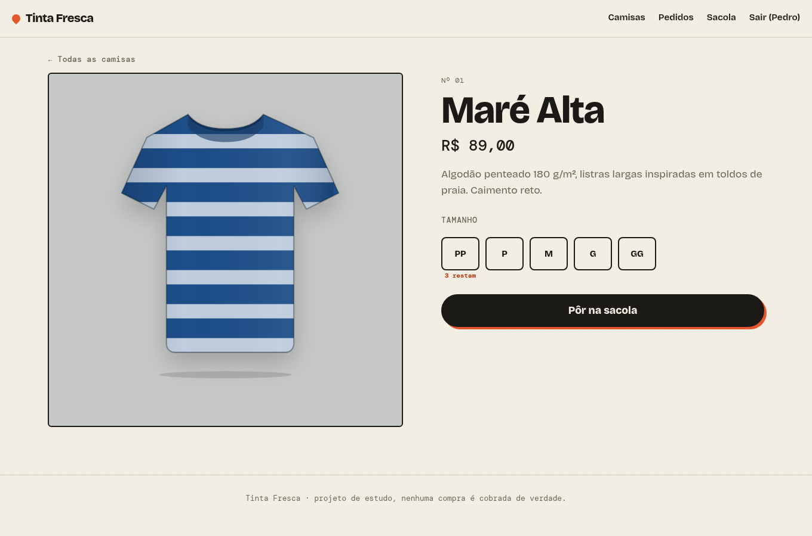
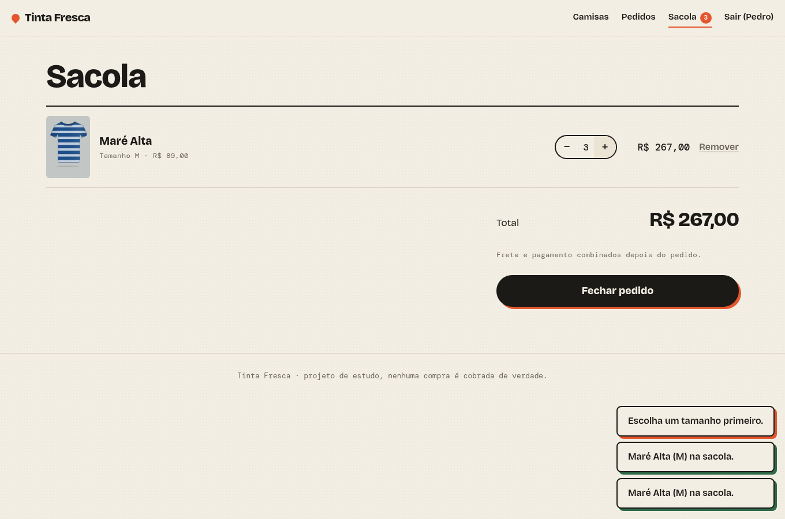
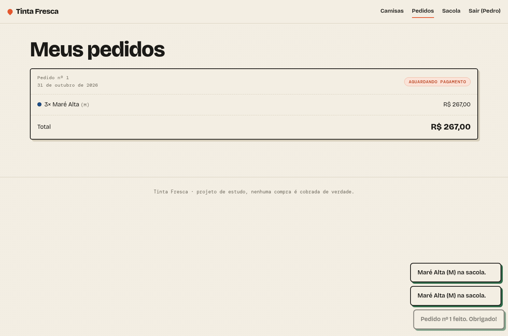

# Tinta Fresca — loja de camisas

Loja online de camisas em edições pequenas: vitrine, escolha de tamanho com estoque real, sacola, pedidos e conta de cliente. API em **Express + SQLite** e front em **React + Vite**.

| Vitrine | Camisa | Sacola | Pedidos |
|---|---|---|---|
|  |  |  |  |

> Projeto de estudo: nenhum pagamento é processado. O pedido fica "aguardando pagamento".

## O que tem

- **Estoque por tamanho**: tamanhos esgotados ficam bloqueados, e "últimas unidades" aparece quando restam poucas.
- **Sacola** com quantidade ajustável, total em tempo real e validação contra o estoque.
- **Fechar pedido é atômico**: confere e baixa o estoque, grava o pedido e esvazia a sacola numa única transação. Se um item acabou no meio do caminho, nada é alterado.
- **Preço nunca vem do cliente**: o servidor recalcula tudo a partir do banco, e o pedido guarda nome e preço da época da compra.
- **Contas**: cadastro e login com senha em bcrypt, JWT, e-mail único sem distinção de maiúsculas, limite de tentativas nas rotas de autenticação.
- **Administração** (`role = admin`): criar, editar (preço, estoque) e remover produtos pela API.
- Camisas desenhadas em **SVG** a partir dos dados (cor + estampa): sem imagens para hospedar.
- Valores em **centavos inteiros** no banco e na API, formatados só na tela.

## Rodando

Precisa de Node 22.13 ou mais novo (usa o SQLite embutido, `node:sqlite`: nada para compilar).

```bash
npm install
npm --prefix Client install

cp .env.example .env        # opcional; defina ADMIN_PASSWORD para criar um administrador
npm run dev                 # API em http://localhost:3000 (cria o banco e o catálogo na 1ª vez)
npm --prefix Client run dev # front em http://localhost:5173 (proxy de /api para a porta 3000)
```

Testes e verificações:

```bash
npm test                        # API: 13 testes (node:test + supertest)
npm --prefix Client test        # front
npm --prefix Client run lint
npm --prefix Client run build
```

## Em produção

`npm --prefix Client run build` gera `Client/dist`, e o Express passa a servir o front no mesmo endereço da API. O `render.yaml` descreve o serviço no Render (disco persistente para o SQLite). Em produção **`JWT_SECRET` é obrigatório**: sem ele o servidor se recusa a subir.

## API

Todas as rotas ficam em `/api`. Erros vêm como `{ "error": "mensagem em português" }`. Rotas marcadas com 🔒 exigem `Authorization: Bearer <token>`.

| Método | Rota | O que faz |
|---|---|---|
| POST | `/users/register` | `{ name, email, password }` → `{ token, user }` |
| POST | `/users/login` | `{ email, password }` → `{ token, user }` |
| GET | `/users/me` 🔒 | usuário atual |
| GET | `/products` | catálogo com estoque por tamanho |
| GET | `/products/:id` | uma camisa |
| POST / PATCH / DELETE | `/products[/:id]` 🔒 admin | criar, editar e remover (remover só desativa) |
| GET | `/cart` 🔒 | sacola com totais |
| POST | `/cart/items` 🔒 | `{ productId, size, quantity }` soma à sacola |
| PUT | `/cart/items` 🔒 | define a quantidade exata (0 remove) |
| DELETE | `/cart` 🔒 | esvazia |
| POST | `/orders` 🔒 | fecha a sacola num pedido |
| GET | `/orders`, `/orders/:id` 🔒 | seus pedidos, com itens |

Dinheiro sempre em centavos (`priceCents`, `totalCents`, `unitPriceCents`). Tamanhos: `PP P M G GG`.

## Estrutura

```
src/          API (app, rotas, validação, banco, autenticação)
scripts/      seed do catálogo
test/         testes da API
Client/src/   React: páginas, componentes, contextos (sessão, sacola, avisos)
```

## O que mudou nesta versão

A primeira versão (2021–22) tinha problemas que esta corrige: o fechamento de pedido quebrava (o preço do produto nunca era carregado), o servidor caía com qualquer requisição sem token, o hash da senha voltava na resposta do cadastro, qualquer usuário podia criar produtos, não havia estoque, `alert()` fazia as vezes de interface, e o front apontava para um endereço fixo. Tudo foi reescrito com testes.
